# Swagger UI walkthrough (animated GIFs)

An end-to-end run of the platform driven entirely through **Swagger UI** by headless Chromium, captured as
one animated GIF per step. Every frame is a real screenshot of the API running in the Docker Compose
profile, and every assertion comes from the HTTP response the browser actually received.

| | |
|---|---|
| Captured by | `tools/walkthrough/capture.mjs` (Playwright) |
| Steps | 18 |
| Server | Docker Compose profile (API, Functions, SQL Server, Redis, Azurite, Keycloak, provider simulator) |
| Test data | `tools/walkthrough/testdata/scenario.json` |
| Machine-readable results | [`artifacts/manifest.json`](artifacts/manifest.json) |
| Uploaded fixture | [`artifacts/timesheets-2026-09-*.csv`](artifacts) (written per run) |

## Test data

Two workers, a September 2026 period, one hourly earning and a 10% deduction each.

| Worker | External ref | Rate | Timesheet | Gross | Tax (10%) | Net |
|--------|--------------|------|-----------|-------|-----------|-----|
| Ada Lovelace | `W-<marker>-001` | 25 / hour | 8h + 8h = 16h | 400 | 40 | 360 |
| Grace Hopper | `W-<marker>-002` | 30 / hour | 8h + 4h = 12h | 360 | 36 | 324 |
| **Total** | | | 28h | **760** | **76** | **684** |

`<marker>` is a per-run token so repeated runs never collide with the unique worker-reference constraint.
Authoritative definitions, including the deduction rule and the expected totals asserted by the
walkthrough, live in `tools/walkthrough/testdata/scenario.json`.

Seed the same data without the UI:

```powershell
cd tools/walkthrough
npm install
npm run seed
```

## The walkthrough

### 1. Open the Swagger UI

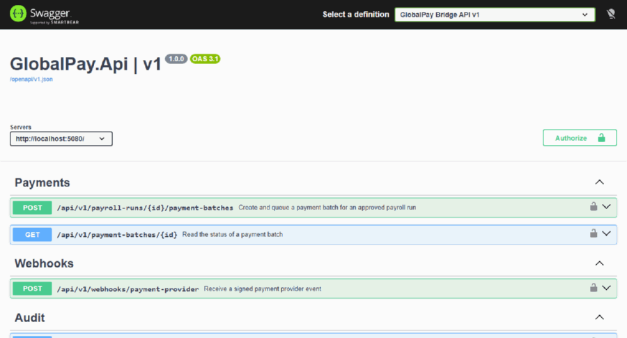

18 operations across eight tag groups: Workers, Timesheet imports, Payroll, Payments, Webhooks,
Reconciliation, Audit and Diagnostics.

### 2. Authorize with an admin token

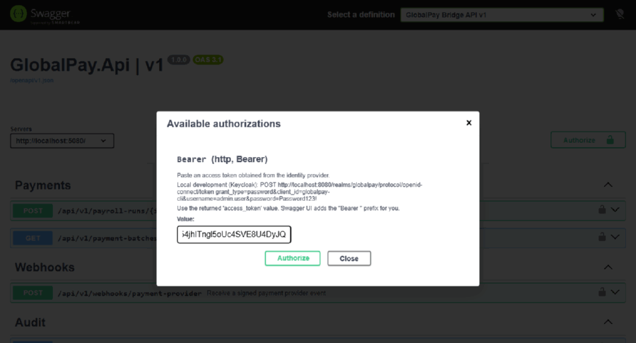

A Keycloak access token is pasted into the bearer scheme declared by
`src/GlobalPay.Api/OpenApi/BearerSecuritySchemeTransformer.cs`. Swashbuckle adds the `Bearer ` prefix and
keeps the token for the session (`persistAuthorization`).

### 3. Create a worker

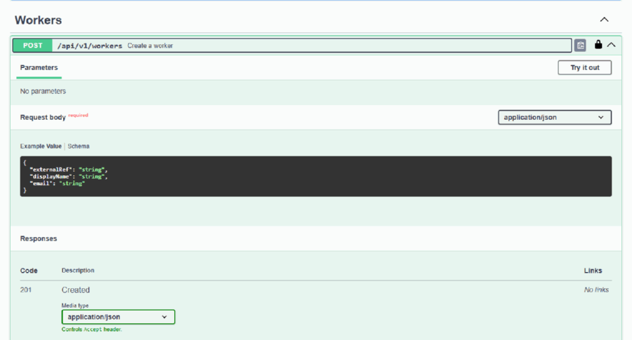

`POST /api/v1/workers` → **201**. Requires the `Admin` role.

### 4. Create the second worker

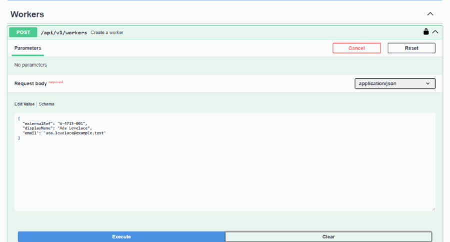

`POST /api/v1/workers` → **201**. Reusing the operation shows Swagger switching from "Try it out" to
"Cancel"/"Reset".

### 5. Create an effective-dated contract

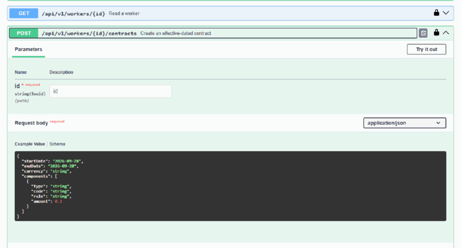

`POST /api/v1/workers/{id}/contracts` → **201**. Compensation components: a `BASE` hourly earning at 25.00
and a `TAX` percent-of-gross deduction at 10%.

### 6. Create the second contract

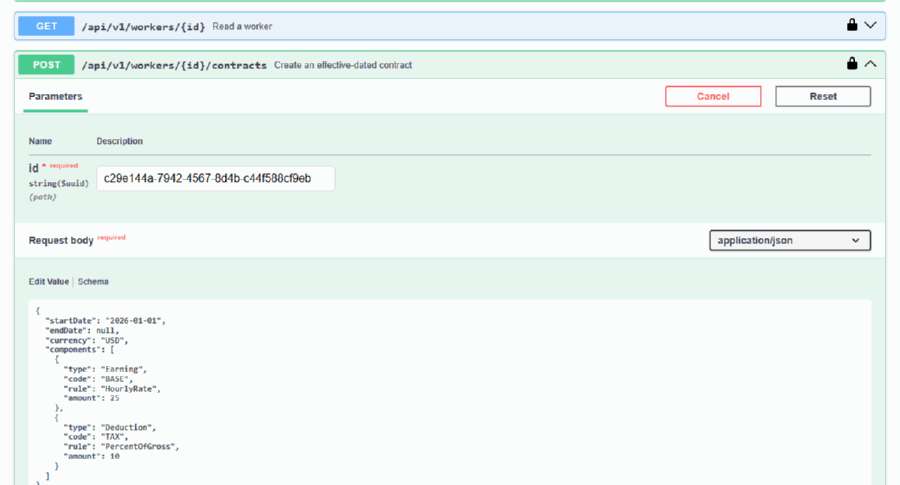

`POST /api/v1/workers/{id}/contracts` → **201**, hourly rate 30.00.

### 7. Register the timesheet import

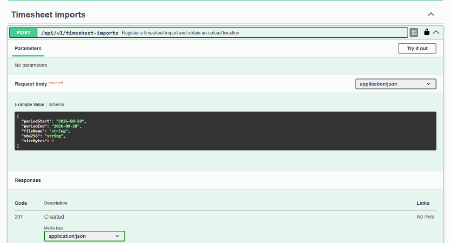

`POST /api/v1/timesheet-imports` → **201**, returning an `importId`, a scoped blob name and a time-limited
SAS **upload** URL.

### 8. Upload the CSV and let the import function process it

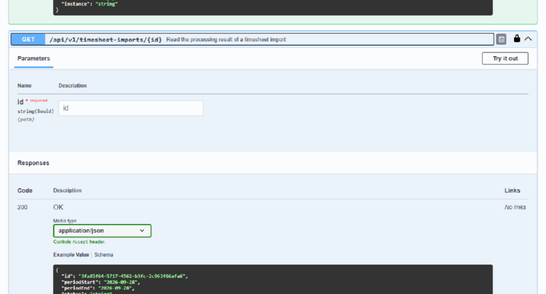

The harness uploads the CSV to the SAS URL (no UI surface exists for a blob upload), the Functions host
picks it up and validates it, and the read operation then reports `Completed` with 4 valid rows. The
registered SHA-256 must match the uploaded bytes.

### 9. Create the payroll run

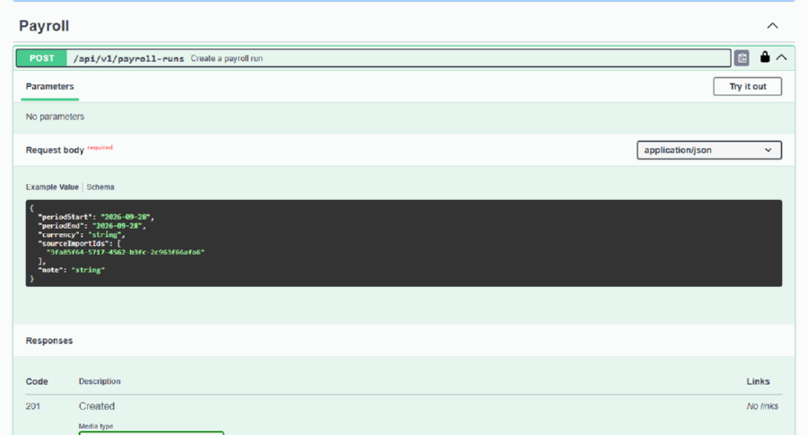

`POST /api/v1/payroll-runs` → **201**, referencing the completed import as `sourceImportIds`.

### 10. Calculate a deterministic snapshot

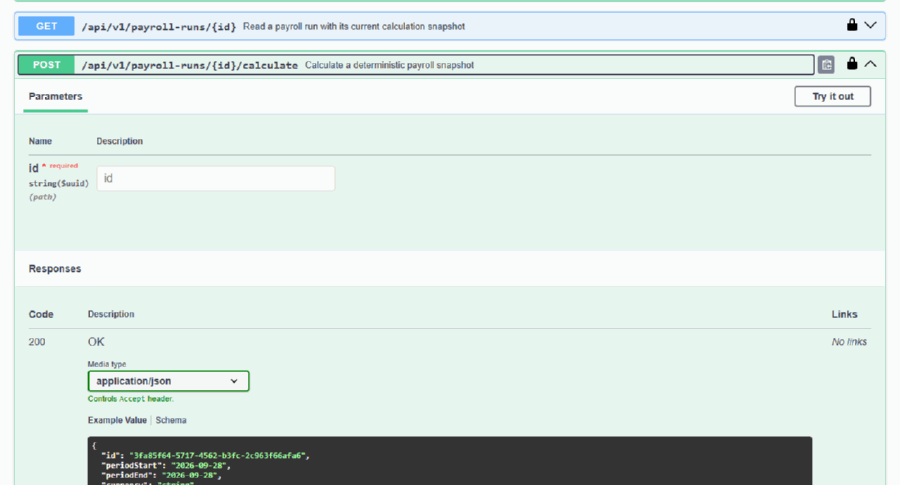

`POST /api/v1/payroll-runs/{id}/calculate` → **200**. The walkthrough asserts the totals: **gross 760,
deductions 76, net 684 for 2 workers**. Calculation is scoped to the run's source imports, so unrelated
imports in the same period cannot leak into the result.

### 11. Submit for approval (maker)

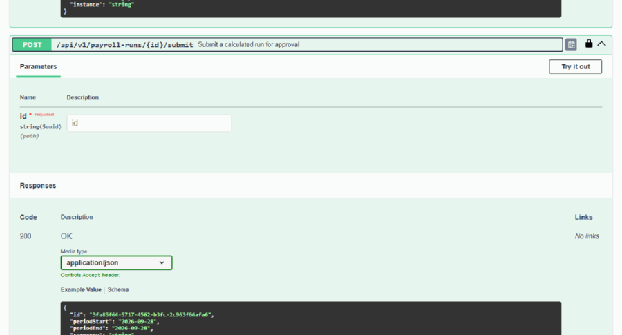

`POST /api/v1/payroll-runs/{id}/submit` → **200**, moving the run to `PendingApproval`.

### 12. Approve as a different user (checker)

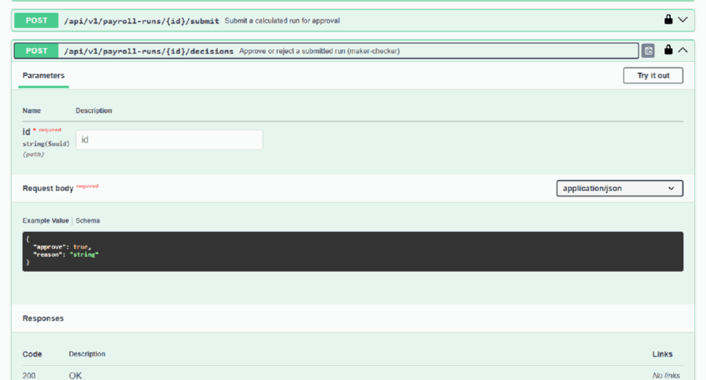

The harness re-authorizes as `approver.user` and calls `POST /api/v1/payroll-runs/{id}/decisions` →
**200**. The response confirms `status = Approved` and `decidedBy = approver.user`. Approving your own run
is rejected by the domain rule `payroll.maker_checker_violation` (covered by unit tests and the
`api-pipeline` integration tests).

### 13. Read the run

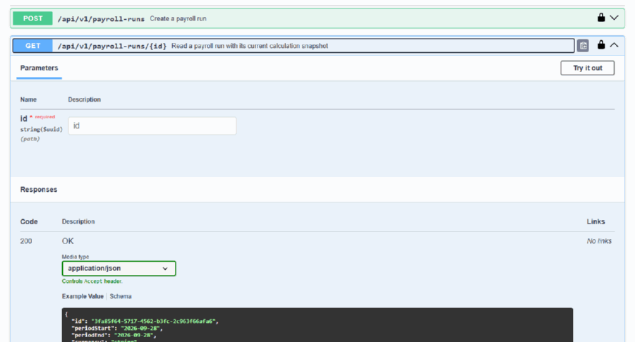

`GET /api/v1/payroll-runs/{id}` → **200**: totals, calculation version, rule version, provenance and the
actions legal for the current user.

### 14. Variance report

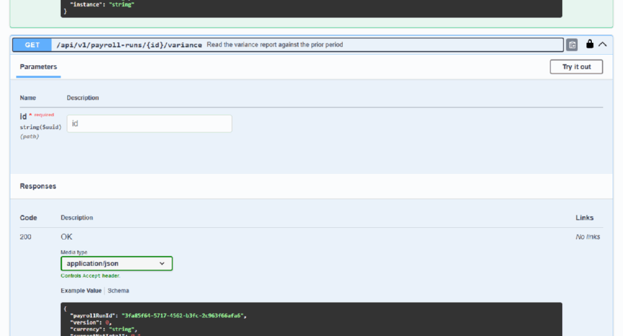

`GET /api/v1/payroll-runs/{id}/variance` → **200**. Available to Admin *or* Approver.

### 15. Finance submits the payment batch

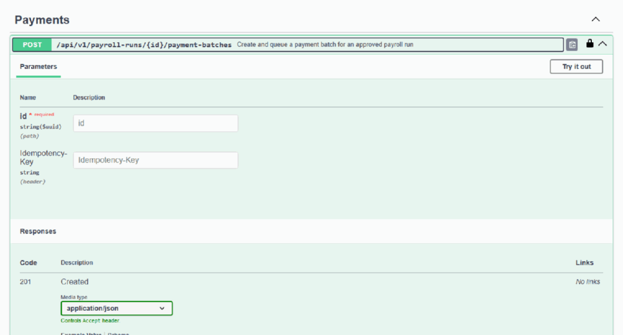

The harness switches to `finance.user` and calls
`POST /api/v1/payroll-runs/{id}/payment-batches` with an **Idempotency-Key** header → **201**. The batch is
created with one instruction per payable worker (net 684 in total) and an outbox message in the same
transaction.

### 16. Outbox dispatch, then a signed webhook settles the batch

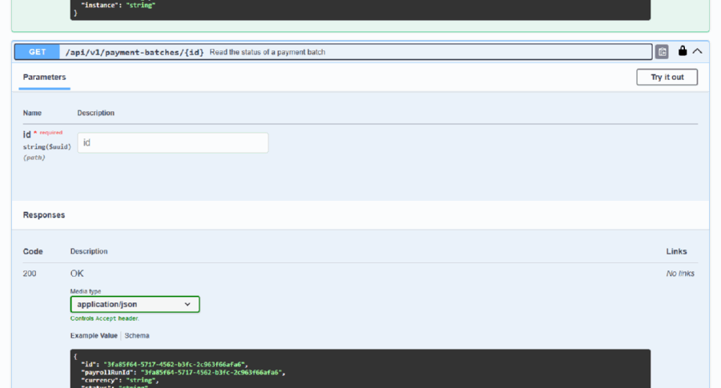

There is no UI for these two machine-to-machine steps, so the harness performs them and then shows the
result in Swagger:

1. the outbox dispatcher (timer trigger) leases the message and submits the batch to the provider
   simulator, which returns a provider reference;
2. a `payment.settled` event is POSTed to the webhook endpoint, signed with HMAC-SHA256 over
   `"{timestamp}.{rawBody}"`.

The read then reports the batch as `Settled`, and the payroll run moves to `Paid`.

### 17. Auditor reads the audit timeline

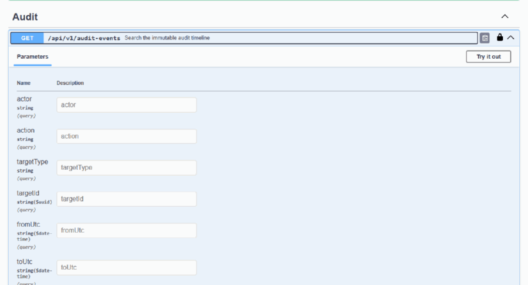

`GET /api/v1/audit-events?limit=20` → **200** as `auditor.user`. Every command in the walkthrough wrote an
immutable audit event.

### 18. Finance reviews reconciliation exceptions

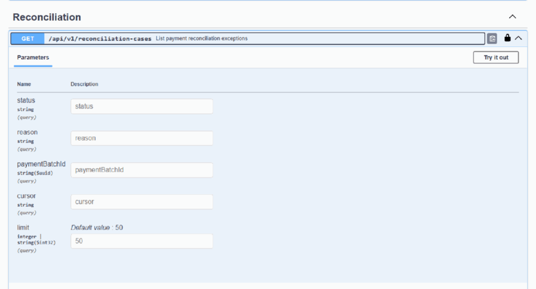

`GET /api/v1/reconciliation-cases?limit=20` → **200**. Cases open for failed or unconfirmed payments;
this run settled cleanly, so the list is empty.

## Reproducing

```powershell
# 1. start the platform and apply the schema
docker compose up -d --build
docker compose cp database/scripts/00-create-database.sql sqlserver:/tmp/00-create-database.sql
docker compose exec -T sqlserver /opt/mssql-tools18/bin/sqlcmd -C -S localhost -U sa -P 'GlobalPay_Local_2026!' -i /tmp/00-create-database.sql
dotnet tool restore
dotnet dotnet-ef database update --project src/GlobalPay.Infrastructure --startup-project src/GlobalPay.Infrastructure

# 2. capture
cd tools/walkthrough
npm install
npx playwright install chromium
node capture.mjs
```

Options:

| Variable | Default | Purpose |
|----------|---------|---------|
| `GPAY_API` | `http://localhost:5080` | API base address |
| `GPAY_TOKEN_URL` | `http://localhost:8080/realms/globalpay/protocol/openid-connect/token` | Token endpoint |
| `GPAY_RUN` | last 4 digits of the timestamp | Run marker used in worker references |
| `GPAY_WEBHOOK_SECRET` | `local-dev-webhook-secret` | Shared secret for webhook signing |

On failure the harness writes `artifacts/failure.png` (the exact viewport state) and
`artifacts/failure.txt`, and exits non-zero.

## How the capture works

- **One GIF per step.** Each step captures 1–4 frames (open, try-it-out, filled, response) and encodes
  them with `gifenc`, resampled to 900 px wide with an area-average filter. No native dependencies and no
  external tools such as `ffmpeg`.
- **Assertions come from the network, not the DOM.** The session listens for responses under `/api/v1`
  and asserts the real status code and body (for example the 2-worker / 760 / 76 / 684 totals). Scraping
  Swagger's rendered JSON would have been brittle and could have hidden a wrong response.
- **Execution waits for the response.** Slow commands (calculation, payment batch) are not sampled until
  the intercepted response arrives and its body has been read, so no frame shows a stale response.
- **Role switches reset authorization.** Swagger hides the token input behind a Logout button once a
  scheme is authorized, so the harness clears the persisted authorization and reloads before signing in
  as a different user.
